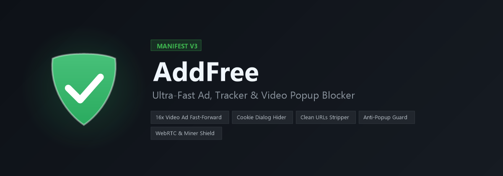

<p align="center">
  
</p>

<p align="center">
  <a href="https://github.com/rayhanvision-a11y/AddFree/archive/refs/heads/main.zip">
    
  </a>
  &nbsp;
  <a href="https://github.com/rayhanvision-a11y/AddFree/releases">
    
  </a>
  &nbsp;
  
</p>

# AddFree: Chrome Ad & Tracker Blocker

A fast, lightweight, and powerful Manifest V3 Chrome Extension that blocks intrusive video ads, popups, redirects, invisible click-trap overlays, cookie consent banners, and tracking parameters across streaming, download, and everyday websites. No external build tool or bundler required.

## 🚀 Quick Download & Install (Chrome)

### Option 1: Direct ZIP Download (Easiest for Everyone)
1. **[Click here to Download AddFree ZIP](https://github.com/rayhanvision-a11y/AddFree/archive/refs/heads/main.zip)**
2. Unzip (extract) the downloaded `AddFree-main.zip` folder on your computer.
3. In Chrome, open `chrome://extensions` in the address bar.
4. Turn ON **Developer mode** toggle in the top-right corner.
5. Click **Load unpacked** in the top-left and select the extracted folder.

### Option 2: Git Clone (One-command updates)
```bash
git clone https://github.com/rayhanvision-a11y/AddFree.git
```
* Load the folder in `chrome://extensions` with **Load unpacked**.
* To update anytime later, simply run `git pull` inside the folder and click **Reload (🔄)** on Chrome Extensions.

## Architecture Overview
| Layer | File(s) | Description |
|---|---|---|
| **Network Engine** | `rules/ad_domains.json`, `rules/tracking_params.json` | DeclarativeNetRequest rules blocking ad networks, popup domains, and stripping URL tracking query parameters. |
| **Scriptlet Engine** | `content/antipopup.js` | Runs at `document_start` in the `MAIN` world. Intercepts `window.open`, defuses anti-adblockers, accelerates countdown timers, blocks push notification spam, prevents WebRTC IP leaks, and blocks in-browser cryptominers. |
| **Cosmetic Filter** | `content/cosmetic.js`, `content/cosmetic.css` | Runs in the isolated world. Removes ads, invisible click-traps, overlays, and social badges. Automatically fast-forwards and skips video ads, dismisses cookie consent dialogs, and manages the interactive Element Picker. |
| **Service Worker** | `background.js` | Closes popup/popunder tabs, prevents ad redirects, auto-syncs remote filters from GitHub, controls context menu actions, and manages per-site whitelisting. |

## Key Features
- **Video Ad Fast-Forward & Auto-Skip (16x)**: Detects pre-roll/mid-roll video ads on YouTube and HTML5 streaming platforms, fast-forwards them at 16x speed while muted, and automatically clicks skip buttons within milliseconds while bypassing anti-adblock prompts.
- **Cookie & CMP Consent Banner Blocker**: Automatically hides annoying GDPR/Cookie dialogs (Cookiebot, OneTrust, Didomi, Quantcast, Complianz, TrustArc, etc.) and restores normal scrolling when a page is locked by a consent wall.
- **Clean URLs & Tracking Parameter Stripper**: Automatically strips tracking codes (`fbclid`, `gclid`, `utm_source`, `utm_medium`, `utm_campaign`, `msclkid`, `twclid`, `igshid`, `si`, etc.) before a page navigates, protecting your browsing privacy.
- **WebRTC Local IP Leak Protection**: Neutralizes ICE candidate harvesting to prevent fingerprinting trackers from discovering your local and private intranet IP address.
- **In-Browser Crypto Mining Blocker**: Prevents rogue Web Workers from executing background CPU mining scripts (CoinHive, CryptoLoot, WebMiner, DeepMiner, MineXMR).
- **Countdown Timer Acceleration**: Speeds up artificial 10-15 second countdown download timers to reveal links almost instantly.
- **Right-Click Context Menu ("Block this element")**: Right-click on any annoying element, badge, or image to remove it instantly with persistent custom rule storage.
- **Element Picker & Rules Manager**: Interactive visual element zapper HUD and a dedicated Manager tab in the popup to review, delete, and backup/restore custom rules.
- **Universal Anti-Adblock Defuser**: Spoofs global bait variables and honeypots so download sites and streaming players function without "Disable AdBlock" walls.
- **Auto GitHub Filter & Code Update Sync**: Automatically syncs newly committed ad rules and domains directly from `rayhanvision-a11y/AddFree` on GitHub in real time (on install, on browser startup, and every 6 hours via Chrome alarms). Also checks for new releases on GitHub and notifies the user directly inside the popup badge.

## Adding Custom Ad Domains
Add the target domain to `tools/domains.txt` under either `[popup]` or `[display]`, then run:
```bash
node tools/build.js
```
Reload the extension in `chrome://extensions` to apply.

## Whitelisting a Website
Click the AddFree shield icon in the browser toolbar, then switch off **"Active on this site"** for the current domain.

## Testing
Open `http://localhost/AddFree/test/` (with Laragon/local web server running) to verify ad element removal, popup blocking, download link unhiding, and timer acceleration.
